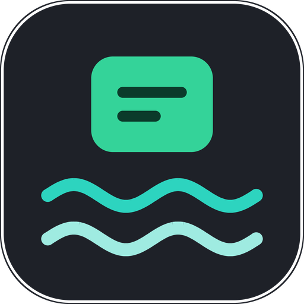
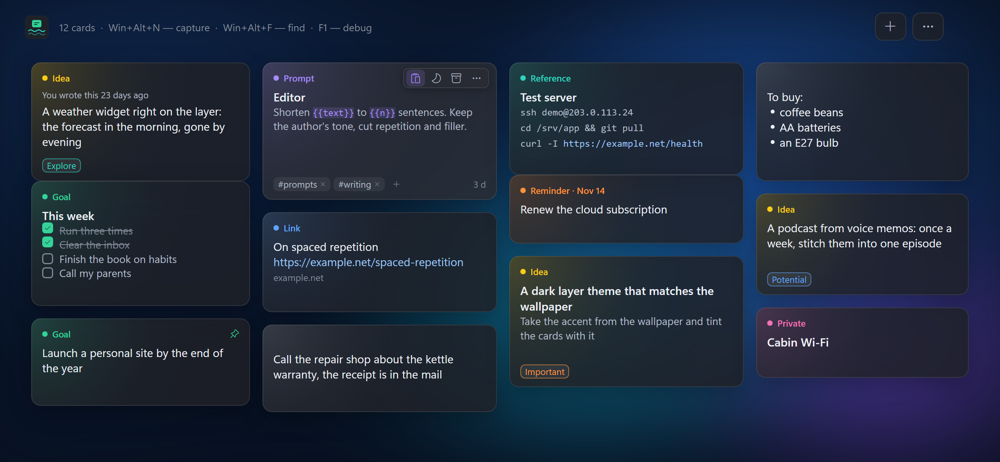
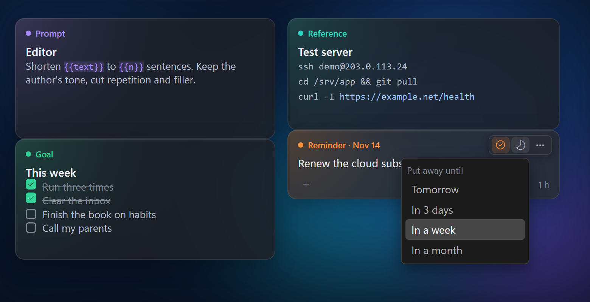
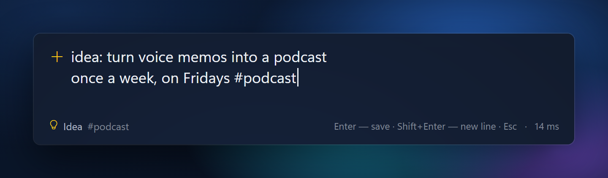
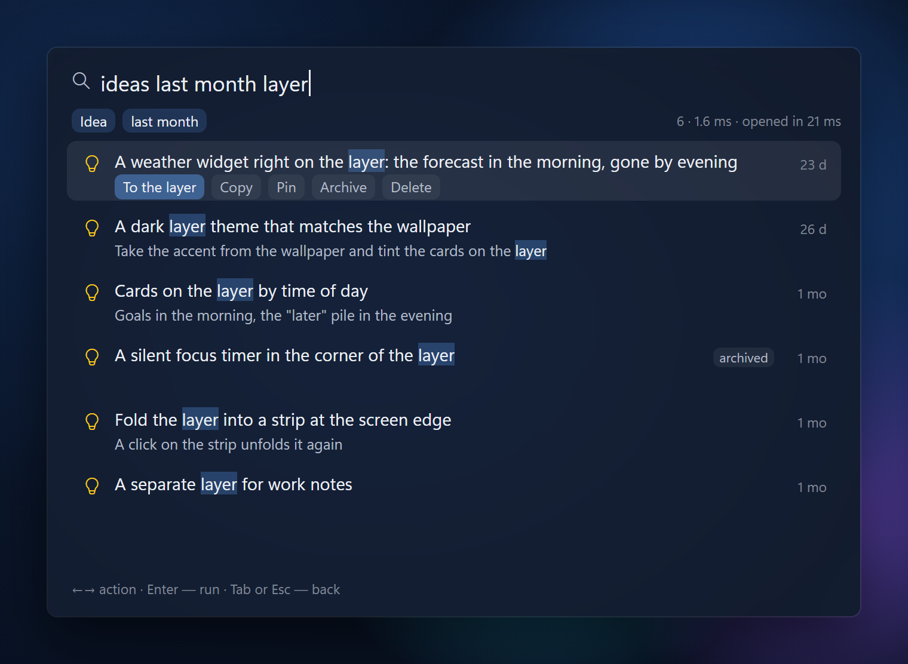

<p align="center"></p>

<h1 align="center">Ebb</h1>

<p align="center">Notes that ebb away and come back on their own.<br>A calm memory layer on your second Windows monitor.</p>

<p align="center"><b>English</b> · <a href="README.ru.md">Русский</a></p>

---

Ebb replaces scattered Sticky Notes: ideas, prompts, links, goals and reminders lie as glass
cards on a separate monitor — under your windows, not on the taskbar. Write it down, stop
holding it in your head, and Ebb brings what matters back into view.

**Capture → Forget → Resurface → Act → Archive**



## Features

- A layer of cards on the monitor you pick, with acrylic blur; drag cards and resize them by any
  edge or corner on a grid, with a magnet that snaps them to their neighbours (hold Alt to place
  freely); long notes scroll.
- A click on the tray icon brings the layer above your windows; Esc or another click sends it
  back. The "⋯" menu in the layer's corner has the same actions as the tray.
- At rest a card is just its text and kind; tags, age and actions appear on hover: the kind's
  main action (open the link, copy the prompt, mark the goal done), pin, copy, "Later", and a
  "⋯" menu with archive and delete.
- A settings window on first launch and when started from the shortcut: layer monitor,
  behaviour, autostart.
- Quick capture from any app — `Win+Alt+N`, with kinds and `#tags` right in the text.
- Instant search (SQLite FTS5) — `Win+Alt+F`; archive and trash — `Win+Alt+L`.
- Imports your open Windows Sticky Notes just as they lie on the screen.
- Lists like in Sticky Notes: a line starting with `- ` gets a bullet, `- [ ]` a checkbox you can
  click to mark the item done. In a Reference every command, path or address copies with one
  button by its line; in a Prompt, `{{variables}}` show up as chips.
- A note editor with mouse selection and formatting: `Ctrl+B`, `Ctrl+I`, `Ctrl+U`,
  strikethrough, highlighter and monospace code, also on a compact toolbar.
- English and Russian UI: the language follows Windows and can be changed in Settings →
  Appearance.
- Tray icon, single instance, autostart at sign-in without Explorer's startup delay.







If a shortcut is taken by another app, Ebb takes the next free one (`Ctrl+Alt+N`, …) — the
current one is shown in the tray menu.

## Install

Download the latest [release](https://github.com/Gerrux/ebb/releases/latest):

- `Ebb-Setup-x.y.z.exe` — installer, no admin rights needed;
- `ebb-x.y.z-windows-x64.zip` — portable `ebb.exe`.

Requires Windows 10 1809+ (Windows 11 recommended). Notes are stored in
`%LOCALAPPDATA%\Ebb\ebb.db` and stay on your machine.

## Build

```powershell
cargo build --release                      # target\release\ebb.exe
powershell -File installer\build.ps1       # + dist\Ebb-Setup-*.exe and zip (needs Inno Setup 6)
```

Command line: `ebb --quit`, `ebb --autostart-on|off|status`.

The icon is generated by `python scripts/make-icon.py` (Pillow) into `assets/`.

## Release

1. Bump `version` in `Cargo.toml`, commit.
2. `git tag vX.Y.Z && git push origin vX.Y.Z` — the `release` workflow builds the installer and
   publishes the release.

Plans and design notes (in Russian) are in [docs/specs](docs/specs/README.md).
